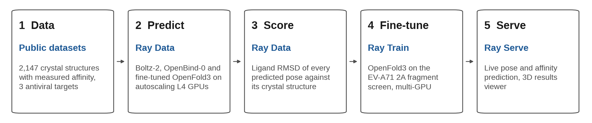

# Co-folding at scale: Boltz-2 and OpenBind-0 on Ray

Published co-folding accuracy comes from curated benchmarks. Drug discovery does
not look like a curated benchmark. It looks like one pocket, hundreds of related
compounds, and chemistry that grows month by month away from anything the model
has seen.

This repository benchmarks three co-folding models against that reality, end to
end on Ray, using three antiviral campaigns with 2,147 experimentally solved
protein-ligand complexes.

| Target | Source | Binding events | Compounds | With affinity |
|---|---|---|---|---|
| EV-A71 2A protease | OpenBind release | 925 | 699 | 601 (pKD) |
| SARS-CoV-2 main protease (Mpro) | ASAP Discovery and COVID Moonshot via Fragalysis | 628 | 308 | 164 (pIC50) |
| MERS-CoV main protease (Mpro) | ASAP Discovery via Fragalysis | 594 | 285 | 142 (pIC50) |


<sub>Real structures and real model outputs for EV-A71 2A compound x7259a.</sub>

---

## Background

**Targets and pockets.** A protein folds into a 3D shape with concave pockets
on its surface. For an enzyme, one of them is the active site. EV-A71 2A
protease cuts the virus's own polyprotein into working parts. Block that site
and the virus cannot assemble.

**Pose and affinity.** A bound molecule is held by hydrogen bonds, packed
hydrophobic surfaces, sometimes a metal ion. Where and how it sits is the pose.
How tightly it is held is the affinity. The 2 are measured separately, and a
molecule can get one right and the other wrong.

**Crystallographic ground truth.** Grow a crystal, soak the compound in,
reconstruct where every atom sits. Slow and expensive, which is why 925 binding
events on 1 target is a notable public dataset.

**Co-folding prediction.**

A co-folding model gets the protein sequence and the ligand SMILES. No structure
for either. It solves both at once, so the pocket can open to accept the ligand
instead of staying fixed. That matters here: a loop beside the 2A active site
sits closed in the empty protein and swings open on binding, and docking into a
fixed receptor fails on exactly that.

**Sequence alignments.** The model also gets a multiple sequence alignment,
hundreds of versions of the same protein from other species. Positions that
mutate together are in contact in 3D. That signal is where most of the folding
accuracy comes from. We precompute 1 alignment per target, because every complex
shares the same protein.

**Pose scoring.** Align the predicted protein onto the crystal protein, then
measure the average distance between matched ligand atoms. Under 2 A is the
field's threshold for correct, about the width of a chemical bond. Above it, the
molecule is in the pocket but turned the wrong way, and anything a chemist
concludes from it is wrong too.

**Discovery campaigns.**


Discovery starts with a fragment screen: molecules of about 15 heavy atoms,
soaked into crystals by the thousand. Most bind nothing. The few that do bind
weakly, and they show which sub-pocket accepts chemistry. Chemists grow those
fragments outward round after round, gaining potency each time.

**Generalization.** These models were trained on the PDB, dense in some protein
families and sparse elsewhere. A model can score well on a benchmark that
resembles its training data and fail on a target it has not effectively
memorized. The OpenBind complexes sit at a median similarity of about 40 to
pre-2021 public structures, on a scale where co-folding success runs 80 to 90
percent above 80 and 10 to 40 percent below 50. Splitting by campaign stage
measures the same property from the other direction.

**Affinity prediction.** Pose is geometry. Affinity is free energy, including
entropy, water displaced from the pocket, and the protein's own flexibility. The
most useful result in the OpenBind paper is a negative one: a molecular weight
baseline beat every structure-based method on rank correlation. Bigger molecules
tend to bind harder, and a model that learns only that has learned nothing about
the pocket.

**Target-specific fine-tuning.** 79 fragment structures teach the model what
this pocket looks like when it is open and what chemistry it accepts. That
transfers to the 802 follow-ons, which share the pocket even when they do not
share the chemistry. Small data doing a lot of work, and the result most
relevant to a discovery team, because every campaign generates fragment
structures early.

---

## Scope

1. Run **Boltz-2**, **OpenBind-0**, and a target fine-tuned **OpenFold3**
   checkpoint over every compound with **Ray Data**, on a cluster that scales
   from zero.
2. **Score** every predicted pose against its crystal structure and compare with
   the published OpenBind numbers.
3. Compare accuracy **across targets** and as compounds **move away from the
   fragment screen**.
4. Browse results in a **3D viewer** and run **live predictions** with **Ray
   Serve**.
5. **Fine-tune** OpenFold3 on the fragment screen with **Ray Train**, then
   benchmark your own weights.



---

## Quickstart

Four commands, assuming the Workspace in [step 1](#step-1-workspace-and-image).

```bash
python setup_data.py                                    # 15 to 20 min, once
python aiddd_pipeline.py --limit 8 --max-gpus 2 \
  --out /mnt/user_storage/aiddd/results/smoke           # 15 min, proves the stack
anyscale job submit -f job.yaml --name aiddd-ev71       # 1 to 2 h, full benchmark
serve run serve_viewer:app                              # viewer and live prediction
```

### 90-minute session format

Pre-stage steps 2, 2b and 4 before the room arrives. What fits live:

| Minutes | What |
|---|---|
| 0 to 10 | Workspace, submit the smoke test, talk while nodes start |
| 10 to 25 | Smoke test results, read the scoring output |
| 25 to 45 | Full benchmark figures, campaign stage and cross-target comparison |
| 45 to 60 | 3D viewer, pose overlays |
| 60 to 80 | Ray Train fine-tune on 2 L4 |
| 80 to 90 | Ray Serve, live prediction on a molecule from the room |

---

## Contents

- [Architecture](#architecture)
- [Repository layout](#repository-layout)
- [Runbook](#runbook)
- [Results](#results)
- [Pipeline design](#pipeline-design)
- [Configuration reference](#configuration-reference)
- [Troubleshooting](#troubleshooting)
- [Data sources and licenses](#data-sources-and-licenses)

---

## Architecture

One Ray Data pipeline per model, all running at the same time on one autoscaling
cluster. Each model gets a fixed share of the GPUs, so no model waits for
another. Scored results feed a Ray Serve app with a leaderboard, a 3D pose
overlay, and live Boltz-2 prediction on an L4.


## Repository layout

| File | Purpose |
|---|---|
| `setup_data.py` | One-time download of the EV-A71 dataset, published benchmark, and model weights |
| `prepare_mpro.py` | One-time build of the SARS-CoV-2 and MERS-CoV Mpro targets |
| `aiddd_pipeline.py` | The Ray Data benchmark pipeline, one target per run |
| `compare_targets.py` | One table across targets, models, and campaign stages |
| `serve_viewer.py` | Ray Serve app: results browser, 3D viewer, live prediction |
| `check_serve.py` | End to end check of the Serve app, including one live prediction |
| `prepare_finetune.py` | Builds the OpenFold3 training set from the EV-A71 2A fragment screen |
| `finetune_ray_train.py` | Fine-tunes OpenFold3 with Ray Train (TorchTrainer, Lightning DDP) |
| `finetune/finetune_ev71.yml` | OpenFold3 training settings used by the fine-tune |
| `job.yaml` | Anyscale Job definition with autoscaling L4 and CPU worker groups |
| `image/Containerfile` | Container image: Ray 2.59, Python 3.12, Boltz-2, OpenFold3 |
| `docs/images/` | Figures in this README, drawn from the runs described here |
| `docs/figures/` | Scripts that redraw every figure and GIF from results under `/mnt/user_storage/aiddd` |

---

## Runbook

Wall clock on the cluster in `job.yaml`.

| Step | What | Time |
|---|---|---|
| 1 | Workspace and image | 5 min, image prebuilt |
| 2 | Download data and weights | 15 to 20 min, once |
| 2b | Build the Mpro targets | about 10 min, once |
| 3 | Smoke test, 8 ligands, three models | 15 to 20 min, mostly node startup |
| 4 | Full benchmark, one target, three models | 1 to 2 h on 8 L4 |
| 5 | Read the results | 5 min |
| 6 | Viewer and live prediction | 5 min |
| 7 | Fine-tune with Ray Train, 150 steps on 2 L4 | about 30 min |

### Step 1. Workspace and image

| Setting | Value |
|---|---|
| Container image | `anyscale/image/aiddd-boltz2-of3:4` |
| Head node | `m5.2xlarge`, CPU only, so notebooks never hold a GPU |
| Worker group | `g6.xlarge` or `g6.2xlarge` (1x L4), min 0, max 4 |

Clone or upload this repository into the Workspace. To build the image yourself:

```bash
anyscale image build -f image/Containerfile -n aiddd-boltz2-of3 -r 2.59.0
```

Then update `image_uri` in `job.yaml` to the version it prints.

> **Python 3.12.** Boltz-2 pins an older SciPy that does not build on 3.13.
> The image also carries a second, isolated OpenFold3 0.4.3 install at
> `/opt/of3-legacy`, because the released fine-tuned checkpoint only loads there.

### Step 2. Download data and weights

All data lives in `/mnt/user_storage/aiddd`, readable from Workspaces and Jobs.

```bash
anyscale job submit -f job.yaml --name aiddd-setup -- python setup_data.py
```

```
/mnt/user_storage/aiddd/
  raw/OpenBind_EV-A71_2A/      structures, metadata CSV, FASTA, MSA        (500 MB)
  EV-A71_2A_benchmark/         published OpenBind results, for comparison  (11 MB)
  boltz_cache/                 Boltz-2 weights and chemical component data (6 GB)
  of3_cache/                   OpenBind-0 and fine-tuned OF3 checkpoints   (9 GB)
```

Safe to rerun; anything already present is skipped. Use `--skip-of3` for
Boltz-2 only.

### Step 2b. Build the Mpro targets

```bash
anyscale job submit -f job.yaml --name aiddd-mpro-setup -- python prepare_mpro.py
```

Downloads the ASAP Discovery and COVID Moonshot structures from Fragalysis,
joins the ASAP potency data, builds one MSA per protein, and writes each target
in the same layout as the OpenBind release.

Campaign stage definitions for the Mpro targets:

| Stage | SARS-CoV-2 Mpro | MERS-CoV Mpro |
|---|---|---|
| fragment | COVID Moonshot XChem fragment screen, 16 heavy atoms or fewer | none |
| early follow-on | ASAP compounds in the Polaris training set | same |
| late follow-on | ASAP compounds in the Polaris test set, made later | same |

Compounds without potency data are staged by crystal order. Binding events more
than 8 A from the catalytic cysteine are excluded from the curated benchmark.

### Step 3. Smoke test

Eight ligands, two fragments and six follow-ons, through all three models:

```bash
anyscale job submit -f job.yaml --name aiddd-smoke -- \
  python aiddd_pipeline.py --models boltz2,openbind0,of3ft \
    --limit 8 --max-gpus 2 --out /mnt/user_storage/aiddd/results/smoke
```

Expected output at the end of the job log:

```
Done in N min. 10 complexes scored -> /mnt/user_storage/aiddd/results/smoke
  Boltz-2: {'ok': 8}
  OpenBind-0 (OF3): {'ok': 8}
  OF3 fine-tuned on EV-A71 2A: {'ok': 8}
```

`cached` instead of `ok` is also success: an earlier run already predicted that
ligand. Any `failed` count prints the first error underneath.

### Step 4. Full benchmark

```bash
anyscale job submit -f job.yaml --name aiddd-ev71        # EV-A71 2A, the job.yaml default
anyscale job submit -f job.yaml --name aiddd-sars2 -- \
  python aiddd_pipeline.py --target sars2-mpro --models boltz2,openbind0,of3ft --max-gpus 8
anyscale job submit -f job.yaml --name aiddd-mers -- \
  python aiddd_pipeline.py --target mers-mpro --models boltz2,openbind0,of3ft --max-gpus 8
```

Each job runs on its own cluster, so all three can run at once. Open the Ray
Dashboard from the Job page and watch L4 and CPU nodes join as the queue fills.

Jobs are resumable. Predictions are cached per ligand, so resubmitting after an
interruption only predicts what is missing.

---

## Results


Panels a and b show, for every error threshold on the x axis, the share of poses
within that error of the crystal. Higher and further left is better. The dashed
line is the 2 A cutoff for a correct pose. Panels c and d split the 2 A success
rate by campaign stage. The fine-tuned model was trained on the EV-A71 2A
fragment screen, so its EV-A71 2A fragment score in panel c is not held out. Its
follow-on and SARS-CoV-2 scores are.

Reference results from our runs, share of poses under 2 A on the curated set,
one sampled pose per ligand:

| Model | EV-A71 2A fragments | EV-A71 2A follow-ons | SARS-CoV-2 fragments | SARS-CoV-2 follow-ons |
|---|---|---|---|---|
| Boltz-2 | 21.6% | 3.2% | 37.5% | 87% |
| OpenBind-0 | 28.4% | 92.7% | 17.5% | 89% |
| OF3 fine-tuned on EV-A71 2A | 81.1% | 78.9% | 7.5% | 62% |

Boltz-2's predicted affinity ranks compounds with Spearman 0.41 against pKD on
EV-A71 2A (482 ligands) and 0.86 against pIC50 on SARS-CoV-2 Mpro (164 ligands).


Spearman 1 would mean the model ranks compounds in exactly the measured order,
0 means no relation. On SARS-CoV-2 Mpro the predictions fall into a weaker and a
stronger cluster, and part of the 0.86 comes from separating them. Within each
cluster the correlation is 0.65 and 0.38.

Summary table terms:

| Term | Meaning |
|---|---|
| Ligand RMSD | Heavy atom distance between predicted and crystal ligand, after aligning the protein on its CA atoms |
| < 2 A | The standard cutoff for a correct pose |
| published | The OpenBind authors' number for the same method on the same complexes |
| stage | Fragment screen, then follow-ons split at the median crystal id. Crystal ids follow campaign time |
| sim | Highest Morgan fingerprint similarity to any fragment-screen ligand. Low similarity means chemistry the fragment screen never showed |

For all targets in one table:

```bash
python compare_targets.py --csv summary.csv
```

The benchmark reports on four axes:

- **Generalization.** Pose accuracy for follow-on compounds, and for compounds
  far from the fragments.
- **Across targets.** Whether a model that does well on one protease does well
  on the others.
- **Target adaptation.** Whether the fine-tuned checkpoint closes that gap, and
  what it costs on the targets it never saw.
- **Affinity.** Whether Boltz-2's predicted affinity ranks compounds the way the
  experiments do.

The full per-complex table is Parquet under `--out`:

```python
import pandas as pd
df = pd.read_parquet("/mnt/user_storage/aiddd/results/ev71-2a")
df.groupby("stage")[["boltz2_lig_rmsd", "openbind0_lig_rmsd", "of3ft_lig_rmsd"]].median()
```

### Step 6. Viewer and live prediction

```bash
python check_serve.py                                              # end to end check
AIDDD_RESULTS=/mnt/user_storage/aiddd/results/ev71-2a serve run serve_viewer:app
```

Open port 8000 from the Workspace **Ports** tab.

- **Leaderboard.** Every crystal complex sorted by ligand RMSD, with model tabs.
- **3D viewer.** Click a row for the predicted ligand (green) over the crystal
  ligand (orange).
- **Live prediction.** Paste a SMILES and press Predict. Boltz-2 runs on an L4
  replica and returns the pose, ligand ipTM, predicted affinity, and binder
  probability. A new molecule takes about a minute. Repeats come back instantly
  from cache.

The deployment autoscales from one to four L4 replicas with traffic.

### Step 7. Fine-tune with Ray Train

The `of3ft` model evaluates a released checkpoint fine-tuned on EV-A71 2A
fragment structures. This step shows how such a checkpoint is made.

**1. Build the training set** (CPU, about 30 s, once):

```bash
python prepare_finetune.py --check
```

Selects fragment-screen complexes with a valid reference pose, no suspected
artefact and no covalent ligand, one per compound (66 complexes), and writes
them in the format OpenFold3's training data loader reads. `--check` loads a few
samples back through OpenFold3's own `WeightedPDBDataset` to prove the format.

**2. Train** (2 L4 GPUs, about 30 min including node startup):

```bash
anyscale job submit -f job.yaml --name aiddd-finetune -- \
  python finetune_ray_train.py --num-workers 2 --max-steps 150
```

```
step  150  loss   0.132  avg10   0.113  distogram  1.711  lr 1.0e-04    8.2 s  13.6 GB

Done in 27.7 min: 150 steps on 2 workers
  loss                           first 10 steps 0.138 -> last 10 steps 0.113
  lddt_inter_protein_ligand_step first 10 steps 0.434 -> last 10 steps 0.576
  median step time 9.2 s, peak GPU memory 13.6 GB
  weights: /mnt/user_storage/aiddd/finetune/runs/<name>/checkpoint_.../of3_ev71_ft.pt
```

| Piece | Role |
|---|---|
| `TorchTrainer` + `ScalingConfig(num_workers=N, use_gpu=True)` | One training worker per L4, NCCL process group, nodes scale from zero |
| `RayDDPStrategy`, `RayLightningEnvironment` | Runs OpenFold3's unchanged Lightning loop under Ray instead of torchrun or SLURM |
| `ray.train.report` | Loss terms, learning rate, step time and GPU memory every step, visible in the Ray Dashboard Train view |
| Final checkpoint | A plain OpenFold3 state dict, same format as OpenBind-0 |

Settings live in `finetune/finetune_ev71.yml`, a standard OpenFold3 runner YAML.
The defaults fit one 24 GB L4 per worker: a 192-token budget holds a whole
complex without cropping, and 8 diffusion noise levels per step instead of 48.

| Flag | Default | Description |
|---|---|---|
| `--num-workers` | 2 | GPUs, one complex per GPU per step |
| `--max-steps` | 150 | Optimizer steps |
| `--lr` | 1e-4 | Peak learning rate, reached after `--warmup-steps` (10) |
| `--diffusion-samples` | 8 | Noise levels per complex per step |
| `--export-ema` | off | Export the EMA weights instead of the raw weights |


OpenBind-0 already predicts these fragment complexes well, so the starting loss
is low and single steps are noisy. Each worker sees a different complex, and the
diffusion loss depends on the noise level drawn at random each step. Leaving out
the first step, which includes kernel compilation, training loss is nearly flat
over 150 steps, 0.120 to 0.117 across the first and last 20 steps. The clearer
signal is `lddt_inter_protein_ligand_step`, the protein-ligand lDDT of a short
structure rollout during training, which rises from 0.44 to 0.57. This is a
demonstration scale run. The released `of3ft` checkpoint was trained for 1,000
steps on 8 GPUs.

**3. Benchmark your weights.** The pipeline has a fourth model, `of3ray`, using
the most recent weights from this step or `--of3ray-ckpt <file>`:

```bash
anyscale job submit -f job.yaml --name aiddd-of3ray -- \
  python aiddd_pipeline.py --models of3ray,of3ft,openbind0
```

Delete `/mnt/user_storage/aiddd/predictions/of3ray` after retraining, since
predictions are cached per ligand.

---

## Pipeline design

**One prediction per ligand, scored against every crystal.** On EV-A71 2A, 925
binding events come from 699 unique ligands, because some crystals hold two
copies. Predicting once per ligand and scoring against each binding event saves
about 25% of GPU time.

**Batching amortizes model loading.** Each GPU actor takes a batch of ligands and
runs one `boltz predict` or `run_openfold predict` call for the whole batch, so
weights load once per batch instead of once per ligand.

**Several predictors per GPU.** One complex of 150 to 300 residues uses under
5 GB and cannot keep an L4 busy alone. The GPU idles while a predictor loads
weights and featurizes on CPU, and OpenFold3's small kernels leave it at about
35% even while running. The pipeline runs 3 OpenFold3 or 2 Boltz-2 predictors
per GPU using fractional `num_gpus`, so one computes while another prepares.
Measured on one L4, EV-A71 2A, 8 ligands per batch:

| Predictors per L4 | GPU activity | Seconds per ligand | GPU memory |
|---|---|---|---|
| OpenFold3, 1 | 32% | 19.9 | 2.9 GB |
| OpenFold3, 2 | 76% | 11.0 | 7.8 GB |
| OpenFold3, 3 | 82% | 9.5 | 10.1 GB |
| Boltz-2, 1 | 75% | 40.8 | 4.8 GB |
| Boltz-2, 2 | 83% | 43.3 | 9.1 GB |

OpenFold3 gets twice the throughput. Boltz-2 does not, because more than half
its time is the affinity step, which already keeps the GPU 98% busy. Packing
still fills its idle startup gaps, so the default is 2.


**One pipeline per model, run concurrently.** Each model reads the validated
ligand list and runs as its own Ray Data pipeline. The driver starts them
together and joins results before scoring. Chaining models as stages of a single
pipeline makes every stage run at the speed of the slowest one. In a chained
test run, four Boltz-2 GPUs sat at 0% for over ten minutes waiting on an
OpenFold3 stage.

**Fixed GPU shares.** `--max-gpus` is the budget for the whole run, split across
models by measured cost per ligand, with Boltz-2 costing about twice an
OpenFold3 model. Each model gets a fixed actor pool of that size
(`ActorPoolStrategy(size=n, max_tasks_in_flight_per_actor=1)`). Ray Data adds
nodes when CPU or memory is busy, so fractional GPU actors that fit on the first
nodes would never trigger a scale up. A fixed pool is always requested, so the
cluster grows straight to the budget. One batch in flight per actor stops
batches queueing behind a busy actor while another sits idle at the end.

**GPU utilization report.** The first predictor on each GPU node samples
`nvidia-smi` every 5 s, and the job log ends with mean utilization per node.
Measured on MERS-CoV Mpro with 8 L4s, once all nodes were up:

| Pipeline design | GPU utilization |
|---|---|
| One predictor per GPU, models chained | about 60% across the cluster |
| Packed, models chained | 0% on the 4 Boltz-2 nodes, 43 to 92% on the others |
| Packed, one pipeline per model (default) | 93% on average while all eight GPUs were up |


**Boltz-2 affinity ensemble.** `--affinity-samples` sets how many diffusion
samples the affinity head uses, default 5. On 160 EV-A71 2A ligands with
measured pKD, one sample ranks compounds as well as five: Spearman 0.37 against
0.36, with the two agreeing at Pearson 0.99.

**Right hardware per stage.** Boltz-2 and OpenFold3 inference both fit on a
24 GB L4 for these proteins, 150 to 306 residues. For larger proteins, add an
L40S worker group to `job.yaml` and pass `--of3-accelerator L40S`. Validation
and scoring run on CPU nodes.

**One MSA per target.** Every complex of a target shares one protein, so a
single precomputed MSA is reused for every prediction. No MSA server is called
at runtime.

**Pose scoring.** The predicted protein is aligned on CA atoms to the crystal
chain the ligand actually contacts. Many crystals contain two protein copies,
and aligning to the wrong one adds 30 to 40 A. Ligand RMSD uses element-matched
optimal assignment, which handles symmetric groups without needing bond orders.

**Caching and resume.** Each ligand's structure (CIF) and metrics (JSON) are
written to shared storage as soon as they finish. Reruns skip them.

---

## Configuration reference

### `aiddd_pipeline.py`

| Flag | Default | Description |
|---|---|---|
| `--target` | `ev71-2a` | `ev71-2a`, `sars2-mpro`, or `mers-mpro` |
| `--models` | `boltz2,openbind0` | Any of `boltz2`, `openbind0`, `of3ft`, `of3ray` |
| `--limit` | all | First N ligands, a fixed mix of fragments and follow-ons |
| `--batch-size` | 8 | Ligands per GPU call. 8 to 16 works well |
| `--boltz-per-gpu` | 2 | Boltz-2 predictors sharing one GPU |
| `--of3-per-gpu` | 3 | OpenFold3 predictors sharing one GPU |
| `--max-gpus` | 8 | GPUs for the whole pipeline, split across models by cost |
| `--accelerator` | `L4` | GPU type for Boltz-2, and OF3 unless overridden |
| `--of3-accelerator` | same as `--accelerator` | GPU type for the OpenFold3 stages |
| `--diffusion-samples` | 1 | Poses sampled per ligand |
| `--affinity-samples` | 5 | Boltz-2 affinity ensemble size, cached separately |
| `--affinity-only` | off | Only ligands with an experimental affinity |
| `--of3ray-ckpt` | latest Ray Train run | Weights for the `of3ray` model |
| `--out` | `$AIDDD_SHARED/results/<target>` | Output Parquet directory |

### Environment variables

| Variable | Default | Used by |
|---|---|---|
| `AIDDD_SHARED` | `/mnt/user_storage/aiddd` | All scripts: data, weights, predictions, results |
| `AIDDD_RESULTS` | `$AIDDD_SHARED/results/ev71-2a` | `serve_viewer.py` |

---

## Troubleshooting

| Symptom | Cause and fix |
|---|---|
| `Missing /mnt/user_storage/aiddd/...` | Data not downloaded. Run step 2 or step 2b |
| Job sits at `pending=1` actors for several minutes | GPU nodes are starting. First node startup takes 3 to 6 minutes |
| `InsufficientInstanceCapacity` | The cloud is out of that GPU type. `enable_cross_zone_scaling` retries other zones. If every zone fails, drop `--of3-accelerator L40S` so everything runs on L4 |
| `Default checkpoint ... not found` from OpenFold3 | `of3_cache` is incomplete. Rerun `python setup_data.py` |
| `of3ft` fails with missing or unexpected state dict keys | The job is not using the project image, so `/opt/of3-legacy` is missing. Check `image_uri` |
| CUDA out of memory in an OpenFold3 stage | Lower `--batch-size`, or add an L40S group and pass `--of3-accelerator L40S` |
| Viewer shows `not scored yet` | `AIDDD_RESULTS` points to a run without that model |
| Live prediction never returns | No L4 available to the Workspace. Add an L4 worker group |

---

## Data sources and licenses

| Resource | Source | License |
|---|---|---|
| OpenBind EV-A71 2A structure and affinity release | [Zenodo 10.5281/zenodo.22142262](https://zenodo.org/records/22142262) | CC0 |
| OpenBind benchmark results | [OpenBind-Consortium/EV-A71_2A_benchmark](https://github.com/OpenBind-Consortium/EV-A71_2A_benchmark) | Apache 2.0 |
| Boltz-2 | [jwohlwend/boltz](https://github.com/jwohlwend/boltz) | MIT |
| OpenFold3 and OpenBind-0 weights | [aqlaboratory/openfold-3](https://github.com/aqlaboratory/openfold-3) | Apache 2.0 |
| Mpro crystal structures (ASAP Discovery, COVID Moonshot) | [Fragalysis, target CoV-Mpro](https://fragalysis.diamond.ac.uk/) | CC-BY 4.0 |
| Mpro potency (pIC50) | [ASAP x Polaris x OpenADMET challenge](https://huggingface.co/datasets/openadmet/ASAP_Polaris_OpenADMET_challenge) | MIT |
| MSAs for the Mpro targets | [ColabFold MSA server](https://colabfold.mmseqs.com) | |

Reference: *The first OpenBind release: an open experimental structure-affinity
dataset and benchmark for structure-based AI* (bioRxiv, 2026).
