# Co-folding at Scale: Boltz-2 and OpenBind-0 on Ray

Co-folding models predict how a drug candidate binds to its protein target, using only the protein
sequence and the molecule's chemical structure [[4]](#ref-4). Published accuracy numbers usually come from curated
benchmarks that look like the models' training data. Real drug discovery is harder: a single binding
pocket, hundreds of related compounds, and new chemistry that the model has never seen.

This repository tests three co-folding models in that setting and runs the full workflow on Ray.

- **Data:** three antiviral drug discovery campaigns with 2,147 experimentally solved protein-ligand
  structures [[1]](#ref-1), [[12]](#ref-12).
- **Models:** Boltz-2 [[2]](#ref-2), OpenFold3 [[3]](#ref-3) with the OpenBind-0 weights [[1]](#ref-1), and an OpenFold3 checkpoint
  fine-tuned on one target.
- **Workflow on Ray:** distributed inference, pose scoring, fine-tuning, hyperparameter search and a live
  prediction service [[13]](#ref-13).

The repository accompanies a hands-on workshop at the AI Drug Discovery & Development Summit 2026
(`workshop.ipynb`). It can also be run as a standalone benchmark.

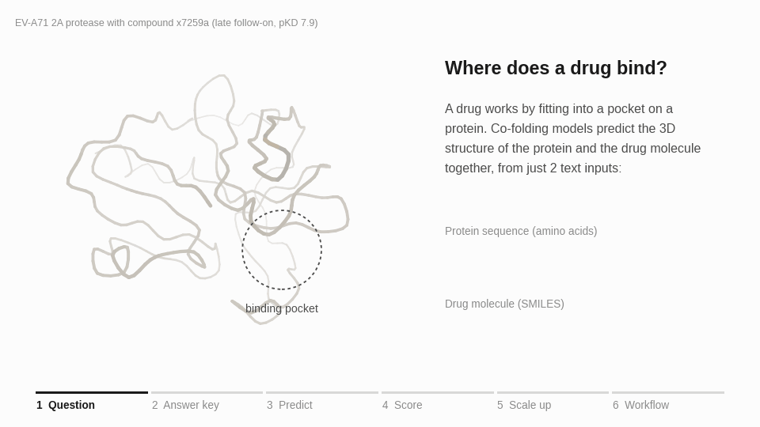

<sub>Experimental structures and model outputs for EV-A71 2A compound x7259a.</sub>

| Target | Source | Binding events | Compounds | With measured affinity |
|---|---|---|---|---|
| EV-A71 2A protease | OpenBind release [[1]](#ref-1) | 925 | 699 | 601 (pKD) |
| SARS-CoV-2 main protease (Mpro) | ASAP Discovery and COVID Moonshot [[12]](#ref-12), via Fragalysis | 628 | 308 | 164 (pIC50) |
| MERS-CoV main protease (Mpro) | ASAP Discovery, via Fragalysis | 594 | 285 | 142 (pIC50) |

## Contents

- [Key findings](#key-findings)
- [Background](#background)
- [Study design](#study-design)
- [Results](#results)
- [Interactive viewer and live prediction](#interactive-viewer-and-live-prediction)
- [System design on Ray](#system-design-on-ray)
- [Repository layout](#repository-layout)
- [Getting started](#getting-started)
- [Runbook](#runbook)
- [Configuration reference](#configuration-reference)
- [Troubleshooting](#troubleshooting)
- [Data sources and licenses](#data-sources-and-licenses)
- [References](#references)

---

## Key findings

- **Accuracy depends strongly on the target.** Boltz-2 predicts 87% of SARS-CoV-2 Mpro follow-on poses
  correctly, but only 3% on EV-A71 2A.
- **Fine-tuning on early data works.** Training OpenFold3 on the EV-A71 2A fragment screen alone raises
  follow-on accuracy on that target to 79%.
- **Fine-tuned models are specialists.** The same checkpoint scores 62 to 69% on the two coronavirus
  proteases, below the 83 to 89% of the general models.
- **More inference compute helps little.** Searching Boltz-2 inference settings with Ray Tune raised its
  EV-A71 2A accuracy from 0% to 13.5%, at about six times the GPU cost.
- **Affinity ranking is uneven.** Boltz-2's predicted affinity correlates with measured values at
  Spearman ρ = 0.41 to 0.86, depending on the target.

---

## Background

### Binding pockets, poses and affinity

- **Binding pocket.** A protein folds into a 3D shape with pockets on its surface. In an enzyme, one of
  them is the active site. The EV-A71 2A protease cuts the viral polyprotein into working parts, so a
  molecule that blocks its active site stops the virus from assembling.
- **Pose.** The position and orientation of a molecule inside the pocket.
- **Affinity.** How tightly the molecule is held. Pose and affinity are measured separately, and a model
  can predict one correctly and the other incorrectly.
- **Crystal structures as ground truth.** X-ray crystallography shows the position of every atom in a
  protein-ligand complex. It is slow and expensive, so 925 public binding events on a single target is
  an unusually rich benchmark.

### Co-folding prediction

A co-folding model receives only the protein sequence and the ligand's SMILES (Simplified Molecular
Input Line Entry System) string, a line of text that encodes the molecule's atoms and bonds [[5]](#ref-5). It
predicts the protein structure and the ligand pose together [[4]](#ref-4), so the pocket can change shape to fit the ligand. This
matters for EV-A71 2A: a loop next to the active site is closed in the empty protein and opens when a
ligand binds. Docking into a fixed protein structure fails in exactly this case.

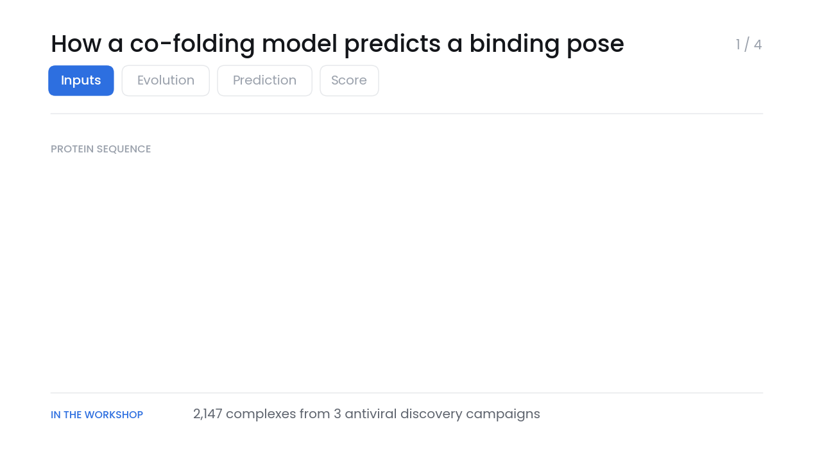

The models also use a **multiple sequence alignment (MSA)**, a set of related protein sequences from
other species. Residues that change together during evolution are usually in contact in 3D, and this
signal drives much of the folding accuracy. Every complex of a target shares the same protein, so the
pipeline computes one MSA per target in advance [[8]](#ref-8).

### Pose evaluation

1. Superpose the predicted protein on the crystal protein.
2. Measure the average distance between matching ligand atoms. This is the **ligand RMSD**.
3. Count the pose as correct if the RMSD is below **2 Å**, about the length of a chemical bond [[9]](#ref-9).

Above 2 Å, the ligand is usually in the pocket but turned the wrong way. Any design idea based on such
a pose is unreliable.

### Structure of a discovery campaign

- **Fragment screen.** Thousands of small molecules (about 15 heavy atoms) are soaked into protein
  crystals. Most do not bind. The few that do bind weakly, but they show which parts of the pocket accept
  chemistry.
- **Follow-on design.** Medicinal chemists grow the best fragments into larger, more potent compounds
  over several design cycles.

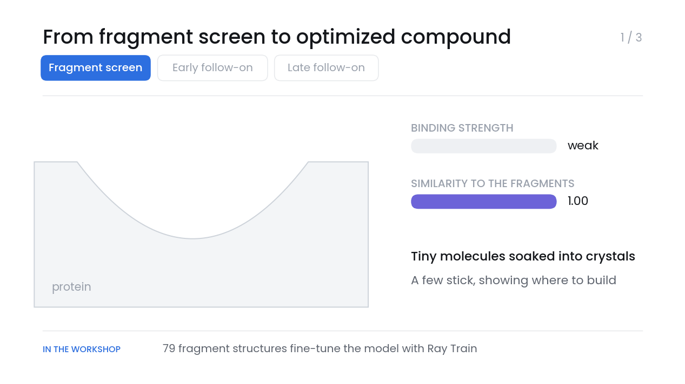

### Generalization to new targets and chemistry

- Co-folding models are trained on the Protein Data Bank [[6]](#ref-6), which covers some protein families well
  and others poorly.
- A model can do well on benchmarks that resemble its training data and poorly on a new target [[7]](#ref-7).
- The OpenBind complexes have a median similarity of about 40 to public structures released before 2021.
  Published co-folding success rates are 80 to 90% above a similarity of 80, and 10 to 40% below 50 [[1]](#ref-1), [[7]](#ref-7).
- Splitting results by campaign stage tests the same question from the chemistry side: follow-on
  compounds move further from anything the model has seen.

### Affinity prediction

Pose is a geometry problem. Affinity is a free energy, which also depends on entropy, water displaced
from the pocket and protein flexibility. The OpenBind study [[1]](#ref-1) reports a striking negative result: a
baseline that uses only molecular weight ranked compounds better than every structure-based method.
Larger molecules tend to bind more tightly, and a model that learns only this trend has learned nothing
about the pocket.

### Target-specific fine-tuning

Fragment-screen structures show a model what the target pocket looks like with a ligand bound, and which
chemistry it accepts. This knowledge carries over to follow-on compounds, which share the pocket even
when their chemistry is new. Every campaign produces fragment structures early, so this is the result
most relevant to a discovery team.

---

## Study design

### Models

| Key | Model | Notes |
|---|---|---|
| `boltz2` | Boltz-2 [[2]](#ref-2) | Predicts pose and binding affinity |
| `openbind0` | OpenFold3 [[3]](#ref-3) with the OpenBind-0 weights [[1]](#ref-1) | General-purpose co-folding model |
| `of3ft` | OpenFold3 fine-tuned on the EV-A71 2A fragment screen [[1]](#ref-1) | Released checkpoint, trained on EV-A71 2A fragments only |
| `of3ray` | OpenFold3 fine-tuned in this repository with Ray Train | Optional, uses the latest local training run |

### Campaign stages

Each binding event belongs to the fragment screen or to the early or late follow-on phase. For EV-A71
2A, follow-ons are split at the median crystal ID, which follows the order of the campaign.

| Stage | SARS-CoV-2 Mpro | MERS-CoV Mpro |
|---|---|---|
| Fragment | COVID Moonshot XChem fragment screen [[12]](#ref-12), up to 16 heavy atoms | None |
| Early follow-on | ASAP compounds in the Polaris training set | Same |
| Late follow-on | ASAP compounds in the Polaris test set, made later | Same |

- Compounds without potency data are staged by crystal order.
- Binding events more than 8 Å from the catalytic cysteine are left out of the curated benchmark.

### Metrics

| Term | Meaning |
|---|---|
| Ligand RMSD | Distance between predicted and crystal ligand atoms after superposing the protein on its Cα atoms |
| Success rate | Share of binding events with ligand RMSD below 2 Å |
| Published | The OpenBind authors' value for the same method on the same complexes [[1]](#ref-1) |
| Similarity | Highest Morgan-fingerprint similarity [[10]](#ref-10) to any fragment-screen ligand |
| pKD, pIC50 | Measured affinity on a log scale. Higher means tighter binding: 6 = 1 µM, 9 = 1 nM |
| Spearman ρ | Rank correlation between predicted and measured affinity. 1 is a perfect ranking, 0 is no relationship |

---

## Results

All values use the curated set and one sampled pose per ligand.

| Model | EV-A71 2A fragments | EV-A71 2A follow-ons | SARS-CoV-2 fragments | SARS-CoV-2 follow-ons |
|---|---|---|---|---|
| Boltz-2 | 21.6% | 3.2% | 37.5% | 87% |
| OpenBind-0 | 28.4% | 92.7% | 17.5% | 89% |
| OpenFold3 fine-tuned on EV-A71 2A | 81.1%* | 78.9% | 7.5% | 62% |

<sub>*Measured on the model's own training data. All other values are on compounds the model has not seen.</sub>

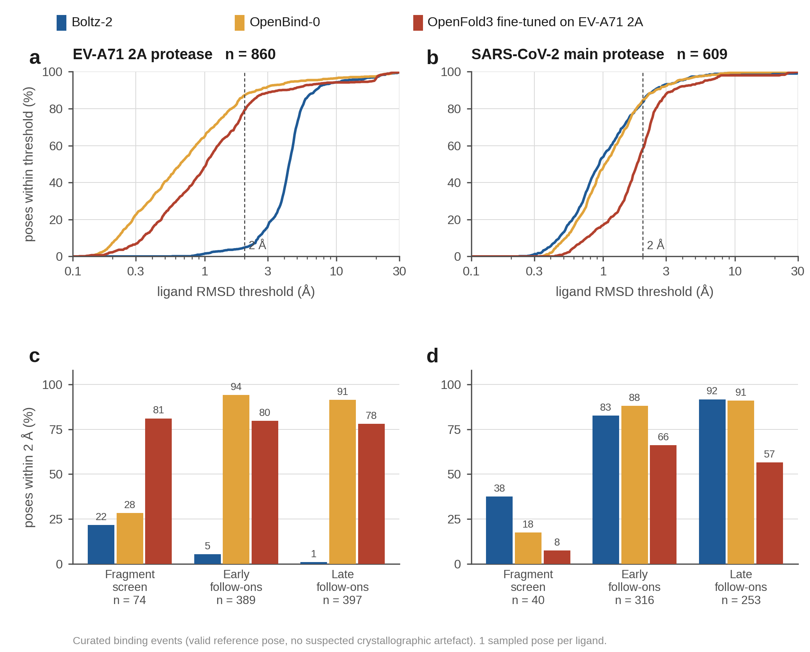

How to read the figure:

- **Panels a and b** show the share of poses within each error threshold. Curves that rise earlier are
  better. The dashed line marks the 2 Å cutoff.
- **Panels c and d** show the 2 Å success rate for each campaign stage.

### Affinity

| Target | Ligands | Spearman ρ |
|---|---|---|
| EV-A71 2A (pKD) | 482 | 0.41 |
| SARS-CoV-2 Mpro (pIC50) | 164 | 0.86 |
| MERS-CoV Mpro (pIC50) | 142 | 0.59 |

On SARS-CoV-2 Mpro, the predictions form a weaker and a stronger cluster, and part of the high
correlation comes from separating the two. Within each cluster, ρ is 0.65 and 0.38.

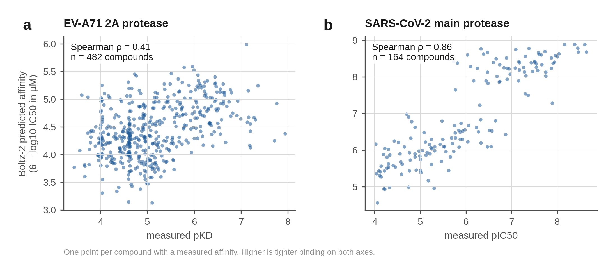

### Case study: one chemical series

The animation follows one EV-A71 2A series from a fragment to a potent follow-on, with each model's
prediction at every step.

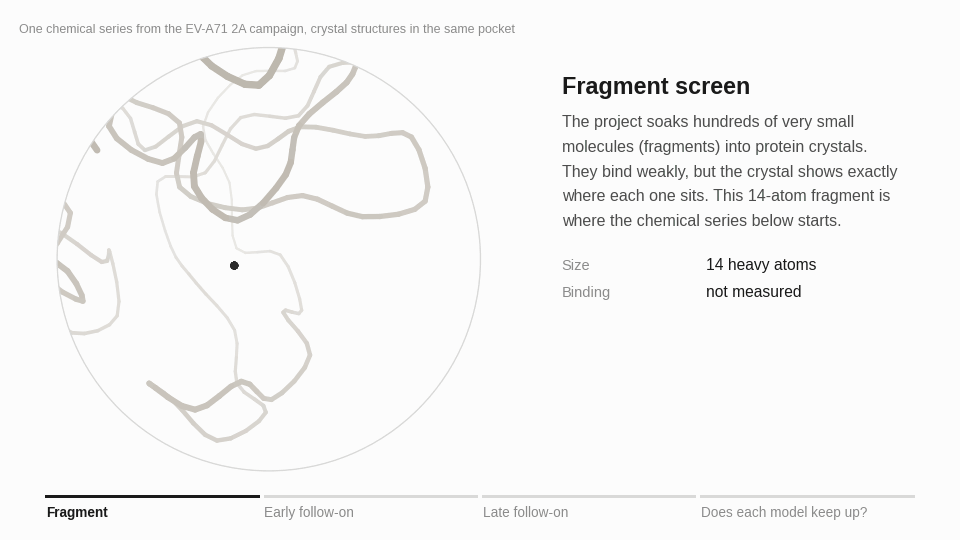

### Reproducibility

```bash
python scripts/compare_targets.py --csv summary.csv
```

The per-complex results are stored as Parquet:

```python
import pandas as pd
df = pd.read_parquet("/mnt/shared_storage/aiddd/results/ev71-2a")
df.groupby("stage")[["boltz2_lig_rmsd", "openbind0_lig_rmsd", "of3ft_lig_rmsd"]].median()
```

---

## Interactive viewer and live prediction

The results are also available as a web application built with Ray Serve. Chemists can browse every
crystal complex, compare each model's prediction with the experimental structure in 3D, and submit new
molecules for a live Boltz-2 prediction.

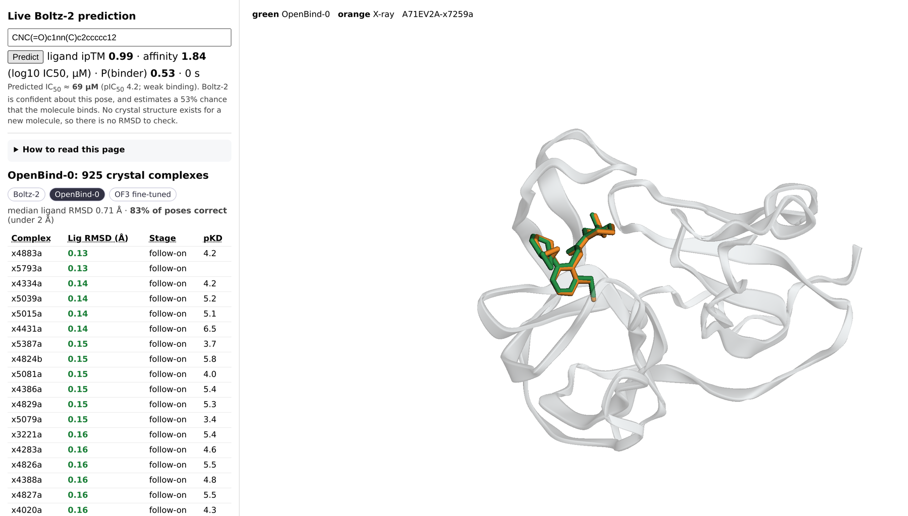

<sub>OpenBind-0's prediction for x7259a (green) overlaps the crystal pose (orange). The live prediction
on the left includes a plain-language reading of the result.</sub>

- **Leaderboard.** Every crystal complex, sorted by ligand RMSD, with a tab for each model.
- **3D comparison.** Selecting a row shows the predicted ligand (green) on the crystal ligand (orange).
- **Live prediction.** Paste a SMILES string to get a predicted pose, confidence and affinity from
  Boltz-2 on an L4 GPU, with an explanation of what the numbers mean. A new molecule takes one to three
  minutes; repeated molecules return instantly from a cache.
- **Built-in guide.** A "How to read this page" panel explains RMSD, pKD, campaign stages and the live
  prediction metrics.
- **Scales with demand.** The Boltz-2 deployment adds GPU replicas as traffic grows, from one to four.

See [Step 5](#step-5-viewer-and-live-prediction) to run it in a Workspace or share it as an Anyscale
Service.

---

## System design on Ray

Each model runs as its own Ray Data pipeline, and all pipelines share one autoscaling cluster. The scored
results feed the Ray Serve application described above.

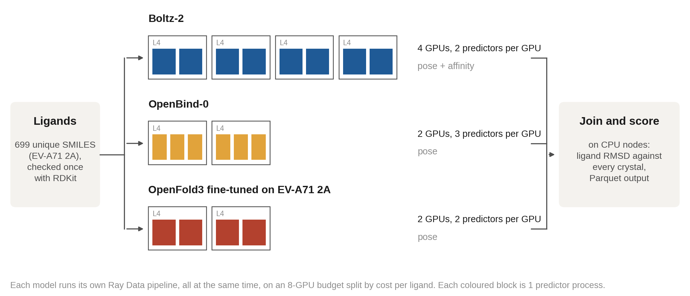

| Ray library | Role in this repository |
|---|---|
| Ray Data | Streaming pipeline: SMILES validation on CPU, model inference on GPU actors, pose scoring on CPU |
| Ray Train | Distributed fine-tuning of OpenFold3, using its own PyTorch Lightning training loop unchanged |
| Ray Tune [[15]](#ref-15) | Learning-rate search with ASHA early stopping [[14]](#ref-14), and a search over Boltz-2 inference settings |
| Ray Serve | Results viewer and live Boltz-2 prediction, with GPU replicas that scale independently |

### Design choices

- **Predict each ligand once.** On EV-A71 2A, the 925 binding events come from 699 unique ligands,
  because some crystals contain two copies. Predicting each ligand once and scoring it against every
  binding event saves about 25% of GPU time.
- **Batch inference.** Each GPU actor processes a batch of ligands in a single `boltz predict` or
  `run_openfold predict` call, so model weights load once per batch.
- **Share each GPU between predictors.** A single complex of 150 to 300 residues uses under 5 GB of GPU
  memory and leaves the GPU idle while inputs are prepared on the CPU. Fractional `num_gpus` requests
  place several predictors on one GPU, so one can compute while another prepares.
- **Run one pipeline per model.** Chaining all models in one pipeline makes every stage wait for the
  slowest. In one test, four Boltz-2 GPUs sat idle for over ten minutes waiting for OpenFold3. Separate
  pipelines avoid this, and the driver joins the results before scoring.
- **Give each model a fixed GPU share.** `--max-gpus` sets the GPU budget, which is split across models
  by their measured cost per ligand. Each model gets a fixed actor pool
  (`ActorPoolStrategy(size=n, max_tasks_in_flight_per_actor=1)`), so the cluster scales straight to the
  budget and no batch waits behind a busy actor.
- **Score against the right protein copy.** Many crystals contain two protein chains. The predicted
  protein is superposed on the chain the ligand actually touches; using the wrong one adds 30 to 40 Å of
  error. Ligand RMSD uses element-matched optimal assignment, which handles symmetric groups.
- **Cache every result.** Each ligand's structure (CIF) and metrics (JSON) are written to shared storage
  as soon as they finish, so interrupted jobs resume where they stopped.
- **Monitor GPU use.** The first predictor on each GPU node samples `nvidia-smi` every five seconds, and
  the job log reports the average utilization per node.

### Throughput with shared GPUs

One L4 GPU, EV-A71 2A, eight ligands per batch:

| Predictors per L4 | GPU activity | Seconds per ligand | GPU memory |
|---|---|---|---|
| OpenFold3, 1 | 32% | 19.9 | 2.9 GB |
| OpenFold3, 2 | 76% | 11.0 | 7.8 GB |
| OpenFold3, 3 | 82% | 9.5 | 10.1 GB |
| Boltz-2, 1 | 75% | 40.8 | 4.8 GB |
| Boltz-2, 2 | 83% | 43.3 | 9.1 GB |

- OpenFold3 runs twice as fast with three predictors per GPU.
- Boltz-2 gains little, because its affinity step already keeps the GPU 98% busy. Two predictors per GPU
  remain the default, since they fill the idle time during startup.

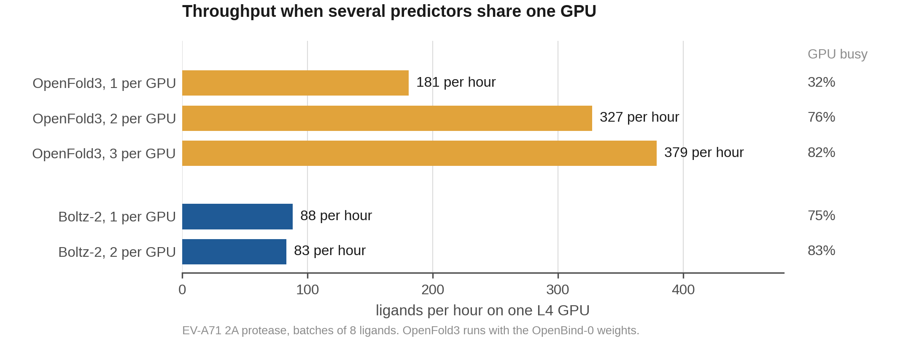

### GPU utilization by pipeline layout

MERS-CoV Mpro, eight L4 GPUs:

| Pipeline layout | GPU utilization |
|---|---|
| One predictor per GPU, models chained | About 60% across the cluster |
| Shared GPUs, models chained | 0% on the four Boltz-2 nodes, 43 to 92% on the others |
| Shared GPUs, one pipeline per model (default) | 93% on average once all nodes were running |

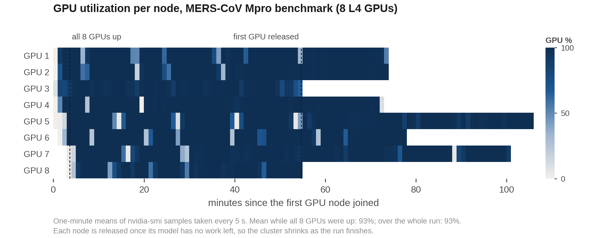

### Additional observations

- **Affinity samples.** On 160 EV-A71 2A ligands, one affinity sample ranks compounds as well as the
  default five (Spearman ρ of 0.37 and 0.36; the two agree at Pearson r = 0.99).
- **Hardware.** Both models fit on a 24 GB L4 GPU for these proteins (150 to 306 residues). For larger
  proteins, add an L40S worker group and pass `--of3-accelerator L40S`.

---

## Repository layout

```
.
├── workshop.ipynb              Hands-on workshop notebook (90 minutes)
├── workshop_helpers.py         Plotting, 3D viewer and data-loading helpers for the notebook
├── aiddd_pipeline.py           Ray Data benchmark pipeline: validate, predict, score (one target per run)
├── finetune_ray_train.py       Ray Train fine-tuning of OpenFold3 (TorchTrainer, Lightning DDP)
├── tune_finetune.py            Ray Tune learning-rate search over complete Ray Train runs
├── tune_boltz.py               Ray Tune search over Boltz-2 inference settings
├── serve_viewer.py             Ray Serve application: results viewer and live prediction
├── job.yaml                    Anyscale Job definition with autoscaling L4 and CPU worker groups
├── service.yaml                Anyscale Service definition for sharing the viewer
├── configs/
│   └── finetune_ev71.yml       OpenFold3 training settings used by the fine-tune
├── scripts/
│   ├── setup_data.py           One-time download of data, published benchmark and model weights
│   ├── prepare_mpro.py         One-time build of the SARS-CoV-2 and MERS-CoV Mpro targets
│   ├── prepare_finetune.py     Builds the OpenFold3 training set from the EV-A71 2A fragment screen
│   ├── compare_targets.py      Summary table across targets, models and campaign stages
│   └── check_serve.py          End-to-end check of the Serve application
├── image/Containerfile         Container image: Ray 2.59, Boltz-2, OpenFold3
└── docs/
    ├── images/                 Figures and animations used in this README and the notebook
    └── figures/                Scripts that redraw every figure from the benchmark results
```

---

## Getting started

With an Anyscale Workspace set up as in [Step 1](#step-1-workspace-and-image), four commands reproduce
the study:

```bash
python scripts/setup_data.py                            # 15 to 20 min, once
python aiddd_pipeline.py --limit 8 --max-gpus 2 \
  --out /mnt/shared_storage/aiddd/results/smoke           # 15 min, checks that everything works
anyscale job submit -f job.yaml --name aiddd-ev71       # 1 to 2 h, full benchmark
serve run serve_viewer:app                              # viewer and live prediction
```

To follow the workshop instead, open `workshop.ipynb` in the Workspace and run the cells in order.

### Workshop format

Complete Steps 2, 2b and 4 before the session. The 90-minute session then runs as follows:

| Minutes | Activity |
|---|---|
| 0 to 10 | Workspace setup; submit the smoke test while nodes start |
| 10 to 25 | Smoke-test results and how to read the scoring output |
| 25 to 45 | Full benchmark: comparison by campaign stage and across targets |
| 45 to 60 | 3D viewer and pose overlays |
| 60 to 80 | Fine-tuning with Ray Train on two L4 GPUs |
| 80 to 90 | Live prediction with Ray Serve for a molecule suggested by the audience |

The Workspace has a limited number of GPUs, so run the notebook cells in order. The Serve application
in Section 7 holds a GPU until the final cell stops it.

---

## Runbook

Times refer to the cluster defined in `job.yaml`.

| Step | Task | Time |
|---|---|---|
| 1 | Workspace and image | 5 min with a prebuilt image |
| 2 | Download data and weights | 15 to 20 min, once |
| 2b | Build the Mpro targets | About 10 min, once |
| 3 | Smoke test: eight ligands, three models | 15 to 20 min, mostly node startup |
| 4 | Full benchmark: one target, three models | 1 to 2 h on eight L4 GPUs |
| 5 | Viewer and live prediction | 5 to 10 min |
| 6 | Fine-tuning with Ray Train: 150 steps on two L4 GPUs | About 30 min |
| 7 | Searches with Ray Tune | 35 to 60 min |

### Step 1. Workspace and image

| Setting | Value |
|---|---|
| Container image | `anyscale/image/aiddd-boltz2-of3:4` |
| Head node | `m5.2xlarge`, CPU only, so the notebook never holds a GPU |
| Worker group | `g6.xlarge` or `g6.2xlarge` (one L4 GPU), minimum 0, maximum 4 |

Clone this repository into the Workspace. To build the image yourself, run the command below, then set
`image_uri` in `job.yaml` and `service.yaml` to the version it prints:

```bash
anyscale image build -f image/Containerfile -n aiddd-boltz2-of3 -r 2.59.0
```

> **Python version.** Boltz-2 requires a SciPy release that does not build on Python 3.13. The image also
> contains a separate OpenFold3 0.4.3 install at `/opt/of3-legacy`, because the released fine-tuned
> checkpoint only loads with that version.

### Step 2. Download data and weights

```bash
anyscale job submit -f job.yaml --name aiddd-setup -- python scripts/setup_data.py
```

All data is stored under `/mnt/shared_storage/aiddd`, which every Workspace, Job and Service in the Anyscale cloud can read, whoever started it:

```
/mnt/shared_storage/aiddd/
  raw/OpenBind_EV-A71_2A/      structures, metadata CSV, FASTA, MSA        (500 MB)
  EV-A71_2A_benchmark/         published OpenBind results                  (11 MB)
  boltz_cache/                 Boltz-2 weights and chemical component data (6 GB)
  of3_cache/                   OpenBind-0 and fine-tuned OF3 checkpoints   (9 GB)
```

- The script skips anything already downloaded and is safe to rerun.
- Pass `--skip-of3` to download Boltz-2 only.

### Step 2b. Build the Mpro targets

```bash
anyscale job submit -f job.yaml --name aiddd-mpro-setup -- python scripts/prepare_mpro.py
```

The script:

- downloads the ASAP Discovery and COVID Moonshot structures from Fragalysis,
- adds the ASAP potency data,
- builds one MSA per protein, and
- writes each target in the same layout as the OpenBind release.

### Step 3. Smoke test

Run eight ligands (two fragments and six follow-ons) through all three models:

```bash
anyscale job submit -f job.yaml --name aiddd-smoke -- \
  python aiddd_pipeline.py --models boltz2,openbind0,of3ft \
    --limit 8 --max-gpus 2 --out /mnt/shared_storage/aiddd/results/smoke
```

The job log ends with a summary like this:

```
Done in N min. 10 complexes scored -> /mnt/shared_storage/aiddd/results/smoke
  Boltz-2: {'ok': 8}
  OpenBind-0 (OF3): {'ok': 8}
  OF3 fine-tuned on EV-A71 2A: {'ok': 8}
```

- `ok` and `cached` both mean success. `cached` means an earlier run already predicted that ligand.
- For `failed` entries, the first error is printed below the summary.

### Step 4. Full benchmark

```bash
anyscale job submit -f job.yaml --name aiddd-ev71        # EV-A71 2A, the job.yaml default
anyscale job submit -f job.yaml --name aiddd-sars2 -- \
  python aiddd_pipeline.py --target sars2-mpro --models boltz2,openbind0,of3ft --max-gpus 8
anyscale job submit -f job.yaml --name aiddd-mers -- \
  python aiddd_pipeline.py --target mers-mpro --models boltz2,openbind0,of3ft --max-gpus 8
```

- Each job runs on its own cluster, so all three targets can run at the same time.
- Predictions are cached per ligand, so a resubmitted job only predicts what is missing.
- While a job runs, the **Metrics** page of the Ray Dashboard shows GPU nodes joining and GPU use per
  node.

### Step 5. Viewer and live prediction

**In a Workspace, for development:**

```bash
python scripts/check_serve.py                                      # end-to-end check
AIDDD_RESULTS=/mnt/shared_storage/aiddd/results/ev71-2a serve run serve_viewer:app
```

Open the Workspace URL with `?port=8000` added. If your browser reports an invalid referer, paste the URL
into a new tab instead of clicking a link to it.

**As an Anyscale Service, to share with a room:**

```bash
anyscale service deploy -f service.yaml          # prints a public URL to share
anyscale service terminate -n aiddd-viewer       # after the session
```

- The Service runs on its own cluster, so it does not compete with the notebook for GPUs.
- Anyone with the URL can open the page and run GPU predictions, on up to four L4 GPUs.
- The Service does not shut down on its own. It keeps at least one L4 GPU running until you terminate
  it.

### Step 6. Fine-tuning with Ray Train

The `of3ft` model is a released checkpoint fine-tuned on EV-A71 2A fragment structures. This step shows
how such a checkpoint is made.

**Build the training set** (CPU, about 30 seconds, once):

```bash
python scripts/prepare_finetune.py --check
```

- Selects fragment-screen complexes with a valid reference pose, no suspected artefact and no covalent
  ligand, one per compound (66 in total).
- Writes them in the format OpenFold3's training data loader reads.
- `--check` loads a sample back through OpenFold3's `WeightedPDBDataset` to confirm the format.

**Train** (two L4 GPUs, about 30 minutes including node startup):

```bash
anyscale job submit -f job.yaml --name aiddd-finetune -- \
  python finetune_ray_train.py --num-workers 2 --max-steps 150
```

```
Done in 27.7 min: 150 steps on 2 workers
  loss                           first 10 steps 0.138 -> last 10 steps 0.113
  lddt_inter_protein_ligand_step first 10 steps 0.434 -> last 10 steps 0.576
  median step time 9.2 s, peak GPU memory 13.6 GB
  weights: /mnt/shared_storage/aiddd/finetune/runs/<name>/checkpoint_.../of3_ev71_ft.pt
```

| Component | Role |
|---|---|
| `TorchTrainer` with `ScalingConfig(num_workers=N, use_gpu=True)` | One training worker per L4 GPU, connected with NCCL; nodes start from zero |
| `RayDDPStrategy`, `RayLightningEnvironment` | Run OpenFold3's Lightning training loop under Ray instead of torchrun or SLURM |
| `ray.train.report` | Reports loss, learning rate, step time and GPU memory at every step |
| Final checkpoint | A standard OpenFold3 state dictionary, in the same format as OpenBind-0 |

Training settings are in `configs/finetune_ev71.yml`, a standard OpenFold3 configuration. The defaults
fit one 24 GB L4 GPU per worker:

- a 192-token budget holds a complete complex without cropping, and
- each step samples 8 diffusion noise levels instead of 48.

| Flag | Default | Description |
|---|---|---|
| `--num-workers` | 2 | Number of GPUs; one complex per GPU per step |
| `--max-steps` | 150 | Optimizer steps |
| `--lr` | 1e-4 | Peak learning rate, reached after `--warmup-steps` (10) |
| `--diffusion-samples` | 8 | Noise levels per complex per step |
| `--export-ema` | off | Export the EMA weights instead of the raw weights |

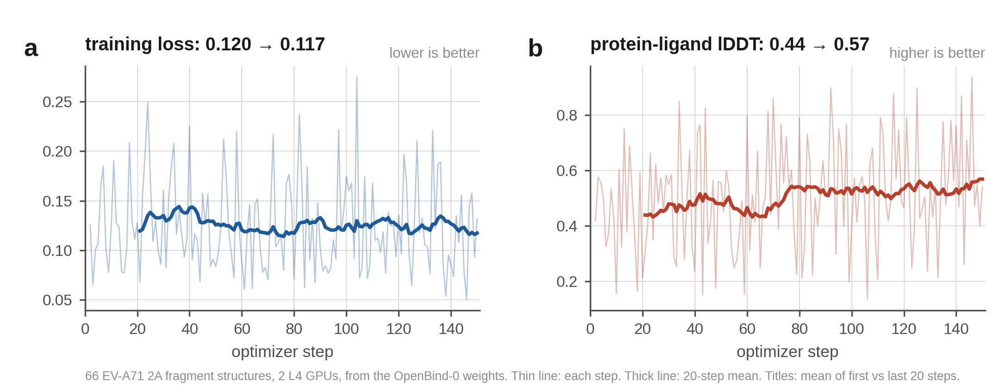

How to read the training curves:

- **Training loss** changes little, because OpenBind-0 already predicts these fragments well. Single steps
  are noisy, since each worker sees a different complex and a random noise level. Over 150 steps the loss
  moves from 0.120 to 0.117 (first and last 20 steps, excluding the first step).
- **Protein-ligand lDDT** [[11]](#ref-11) is the clearer signal. It measures the accuracy of protein-ligand contacts in a
  short structure prediction during training, and rises from 0.44 to 0.57.
- This is a demonstration-scale run. The released `of3ft` checkpoint was trained for 1,000 steps on eight
  GPUs.

**Benchmark the new weights.** The `of3ray` model uses the latest weights from this step, or the file
given by `--of3ray-ckpt`:

```bash
anyscale job submit -f job.yaml --name aiddd-of3ray -- \
  python aiddd_pipeline.py --models of3ray,of3ft,openbind0
```

Predictions are cached per ligand, so delete `/mnt/shared_storage/aiddd/predictions/of3ray` after
retraining.

### Step 7. Searches with Ray Tune

```bash
anyscale job submit -f job.yaml --name tune-ft    -- python tune_finetune.py   # about 35 min on four L4 GPUs
anyscale job submit -f job.yaml --name tune-boltz -- python tune_boltz.py      # about 60 min on eight L4 GPUs
```

- **`tune_finetune.py`** runs each learning rate as a complete Ray Train trial. The ASHA scheduler stops
  weak trials early, and the best weights are tested on held-out early follow-on complexes.
- **`tune_boltz.py`** tests combinations of recycling steps, diffusion samples and physics-based steering
  for Boltz-2, with one L4 GPU per trial.

---

## Configuration reference

### `aiddd_pipeline.py`

| Flag | Default | Description |
|---|---|---|
| `--target` | `ev71-2a` | `ev71-2a`, `sars2-mpro` or `mers-mpro` |
| `--models` | `boltz2,openbind0` | Any of `boltz2`, `openbind0`, `of3ft`, `of3ray` |
| `--limit` | all | First N ligands, a fixed mix of fragments and follow-ons |
| `--batch-size` | 8 | Ligands per GPU call; 8 to 16 works well |
| `--boltz-per-gpu` | 2 | Boltz-2 predictors sharing one GPU |
| `--of3-per-gpu` | 3 | OpenFold3 predictors sharing one GPU |
| `--max-gpus` | 8 | GPUs for the whole pipeline, split across models by cost |
| `--accelerator` | `L4` | GPU type for Boltz-2, and for OpenFold3 unless overridden |
| `--of3-accelerator` | same as `--accelerator` | GPU type for the OpenFold3 stages |
| `--diffusion-samples` | 1 | Poses sampled per ligand |
| `--affinity-samples` | 5 | Boltz-2 affinity ensemble size, cached separately |
| `--affinity-only` | off | Only ligands with a measured affinity |
| `--of3ray-ckpt` | latest Ray Train run | Weights for the `of3ray` model |
| `--out` | `$AIDDD_SHARED/results/<target>` | Output Parquet directory |

### Environment variables

| Variable | Default | Used by |
|---|---|---|
| `AIDDD_SHARED` | `/mnt/shared_storage/aiddd` | All scripts: data, weights, predictions and results |
| `AIDDD_RESULTS` | `$AIDDD_SHARED/results/ev71-2a` | `serve_viewer.py` |

---

## Troubleshooting

| Symptom | Cause and fix |
|---|---|
| `Missing /mnt/shared_storage/aiddd/...` | Data is not downloaded. Run Step 2 or Step 2b |
| Job stays at `pending=1` actors for several minutes | GPU nodes are starting. The first node usually takes three to six minutes |
| `InsufficientInstanceCapacity` | The cloud has no free GPUs of that type. `enable_cross_zone_scaling` tries other zones. If all fail, remove `--of3-accelerator L40S` so every stage uses L4 |
| Fine-tuning reports that the worker group timed out | Not enough free GPUs. Stop the Serve application from Section 7 (`serve shutdown`) and run the notebook in order |
| `Default checkpoint ... not found` from OpenFold3 | `of3_cache` is incomplete. Rerun `python scripts/setup_data.py` |
| `of3ft` fails with missing or unexpected state-dictionary keys | The job is not using the project image, so `/opt/of3-legacy` is missing. Check `image_uri` |
| CUDA out of memory in an OpenFold3 stage | Lower `--batch-size`, or add an L40S group and pass `--of3-accelerator L40S` |
| Viewer shows `not scored yet` | `AIDDD_RESULTS` points to a run that does not include that model |
| Live prediction never returns | No L4 GPU is available to the Workspace. Add an L4 worker group |
| 3D view in the notebook shows only a static picture | The browser does not run scripts in notebook output. Run the cell again, or use the Serve viewer for an interactive view |

---

## Data sources and licenses

| Resource | Source | License |
|---|---|---|
| OpenBind EV-A71 2A structure and affinity release | [Zenodo 10.5281/zenodo.22142262](https://zenodo.org/records/22142262) | CC0 |
| OpenBind benchmark results | [OpenBind-Consortium/EV-A71_2A_benchmark](https://github.com/OpenBind-Consortium/EV-A71_2A_benchmark) | Apache 2.0 |
| Boltz-2 | [jwohlwend/boltz](https://github.com/jwohlwend/boltz) | MIT |
| OpenFold3 and OpenBind-0 weights | [aqlaboratory/openfold-3](https://github.com/aqlaboratory/openfold-3) | Apache 2.0 |
| Mpro crystal structures (ASAP Discovery, COVID Moonshot) | [Fragalysis, target CoV-Mpro](https://fragalysis.diamond.ac.uk/) | CC-BY 4.0 |
| Mpro potency (pIC50) | [ASAP x Polaris x OpenADMET challenge](https://huggingface.co/datasets/openadmet/ASAP_Polaris_OpenADMET_challenge) | MIT |
| MSAs for the Mpro targets | [ColabFold MSA server](https://colabfold.mmseqs.com) | |
| Ray diagrams in the notebook | [Ray documentation](https://docs.ray.io) | Apache 2.0 |

---

## References

1. <a id="ref-1"></a>OpenBind Consortium. OpenBind's first release: a structure–affinity dataset for structure-based AI.
   *bioRxiv* (2026). [doi:10.64898/2026.08.27.747600](https://doi.org/10.64898/2026.08.27.747600)
2. <a id="ref-2"></a>Passaro, S., Corso, G., Wohlwend, J., *et al.* Boltz-2: Towards accurate and efficient binding
   affinity prediction. *bioRxiv* (2025). [doi:10.1101/2025.06.14.659707](https://doi.org/10.1101/2025.06.14.659707)
3. <a id="ref-3"></a>The OpenFold3 Team. OpenFold3-preview (software, version 0.5.0). *Zenodo* (2026).
   [doi:10.5281/zenodo.17485509](https://doi.org/10.5281/zenodo.17485509)
4. <a id="ref-4"></a>Abramson, J., Adler, J., Dunger, J., *et al.* Accurate structure prediction of biomolecular
   interactions with AlphaFold 3. *Nature* **630**, 493–500 (2024).
   [doi:10.1038/s41586-024-07487-w](https://doi.org/10.1038/s41586-024-07487-w)
5. <a id="ref-5"></a>Weininger, D. SMILES, a chemical language and information system. 1. Introduction to methodology
   and encoding rules. *J. Chem. Inf. Comput. Sci.* **28**, 31–36 (1988).
   [doi:10.1021/ci00057a005](https://doi.org/10.1021/ci00057a005)
6. <a id="ref-6"></a>Berman, H. M., Westbrook, J., Feng, Z., *et al.* The Protein Data Bank. *Nucleic Acids Res.*
   **28**, 235–242 (2000). [doi:10.1093/nar/28.1.235](https://doi.org/10.1093/nar/28.1.235)
7. <a id="ref-7"></a>Škrinjar, P., Eberhardt, J., Durairaj, J., Schwede, T. Have protein-ligand co-folding methods
   moved beyond memorisation? *bioRxiv* (2025).
   [doi:10.1101/2025.02.03.636309](https://doi.org/10.1101/2025.02.03.636309)
8. <a id="ref-8"></a>Mirdita, M., Schütze, K., Moriwaki, Y., *et al.* ColabFold: making protein folding accessible to
   all. *Nat. Methods* **19**, 679–682 (2022). [doi:10.1038/s41592-022-01488-1](https://doi.org/10.1038/s41592-022-01488-1)
9. <a id="ref-9"></a>Buttenschoen, M., Morris, G. M., Deane, C. M. PoseBusters: AI-based docking methods fail to
   generate physically valid poses or generalise to novel sequences. *Chem. Sci.* **15**, 3130–3139 (2024).
   [doi:10.1039/D3SC04185A](https://doi.org/10.1039/D3SC04185A)
10. <a id="ref-10"></a>Rogers, D., Hahn, M. Extended-connectivity fingerprints. *J. Chem. Inf. Model.* **50**, 742–754
    (2010). [doi:10.1021/ci100001p](https://doi.org/10.1021/ci100001p)
11. <a id="ref-11"></a>Mariani, V., Biasini, M., Barbato, A., Schwede, T. lDDT: a local superposition-free score for
    comparing protein structures and models using distance difference tests. *Bioinformatics* **29**, 2722–2728
    (2013). [doi:10.1093/bioinformatics/btt473](https://doi.org/10.1093/bioinformatics/btt473)
12. <a id="ref-12"></a>Boby, M. L., Fearon, D., Ferla, M., *et al.* Open science discovery of potent noncovalent
    SARS-CoV-2 main protease inhibitors. *Science* **382**, eabo7201 (2023).
    [doi:10.1126/science.abo7201](https://doi.org/10.1126/science.abo7201)
13. <a id="ref-13"></a>Moritz, P., Nishihara, R., Wang, S., *et al.* Ray: a distributed framework for emerging AI
    applications. In *Proc. 13th USENIX Symposium on Operating Systems Design and Implementation (OSDI)*,
    561–577 (2018). [arXiv:1712.05889](https://arxiv.org/abs/1712.05889)
14. <a id="ref-14"></a>Li, L., Jamieson, K., Rostamizadeh, A., *et al.* A system for massively parallel
    hyperparameter tuning. In *Proc. Machine Learning and Systems (MLSys)* **2** (2020).
    [arXiv:1810.05934](https://arxiv.org/abs/1810.05934)
15. <a id="ref-15"></a>Liaw, R., Liang, E., Nishihara, R., *et al.* Tune: a research platform for distributed model
    selection and training. *arXiv* (2018). [arXiv:1807.05118](https://arxiv.org/abs/1807.05118)
